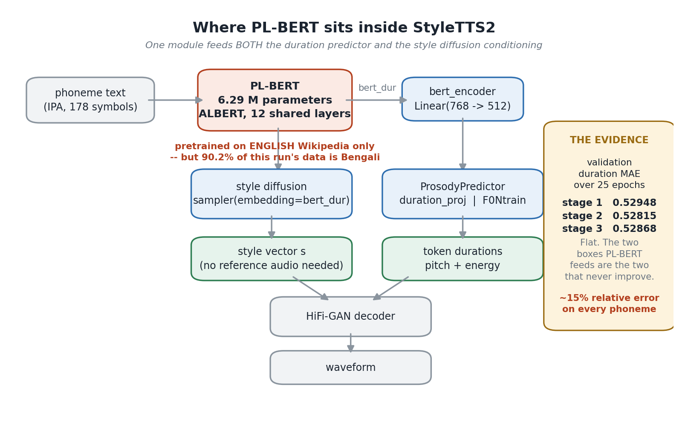
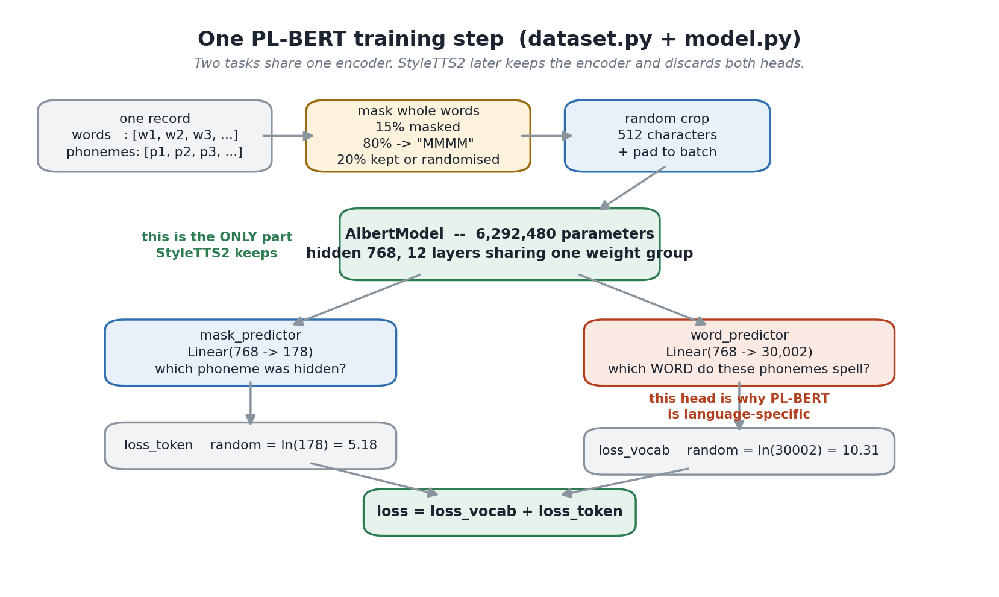
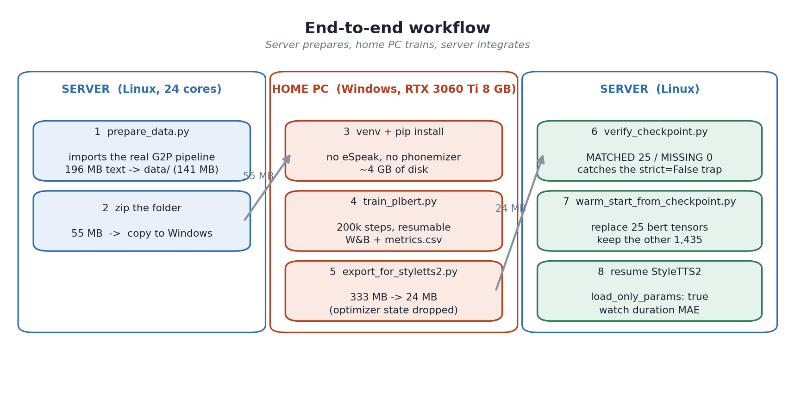
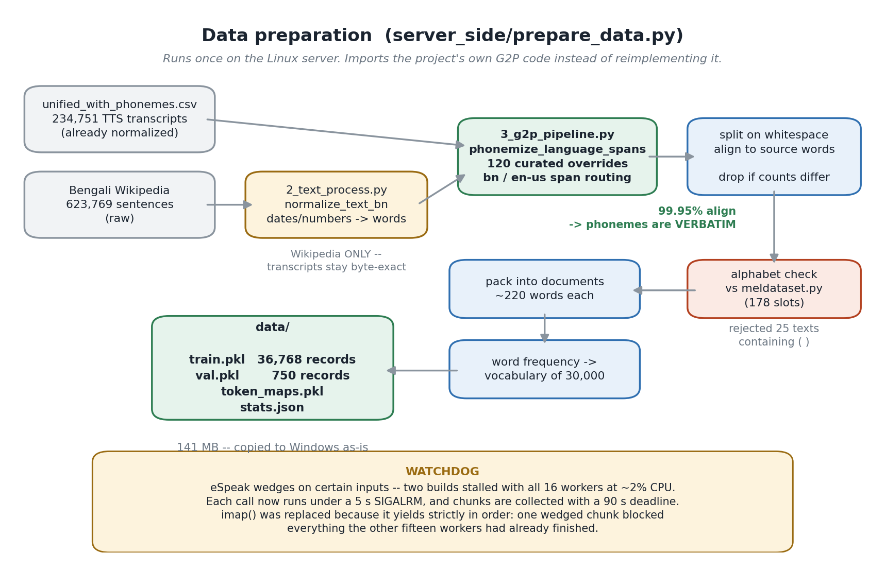

# Bengali PL-BERT

A phoneme-level masked language model for Bengali, trained from scratch on a
single consumer GPU.

Given a sequence of Bengali phonemes, it produces a context-aware vector for
every phoneme — a representation that carries word identity and sentence
structure, not just the sound. Speech synthesis models use those vectors to
decide how long each phoneme should last and how the sentence should be
intoned.

The trained encoder is 6.3 M parameters and exports to a 24 MB file.

---

## Contents

- [Purpose](#purpose)
- [How it works](#how-it-works)
- [Results](#results)
- [Repository layout](#repository-layout)
- [Setup](#setup)
- [Training](#training)
- [Monitoring a run](#monitoring-a-run)
- [Exporting](#exporting)
- [Configuration](#configuration)
- [Data](#data)
- [Troubleshooting](#troubleshooting)

---

## Purpose

A text-to-speech model is given phonemes, not words. Phonemes alone are
ambiguous: the same sound sequence can belong to different words, and nothing
in a bare phoneme string says where one word ends or which syllable carries
the stress. A model that sees only phonemes therefore has to guess timing and
intonation from very little.

PL-BERT closes that gap. It is pretrained to recover the **word** behind each
phoneme and to fill in **masked phonemes** from context, so its output
encodes lexical and syntactic information that the raw phoneme string does
not. A synthesis model consuming those vectors gets a much stronger signal for
duration and prosody.

Pretrained PL-BERT checkpoints exist for English and for a 16-language
multilingual mix. **Neither includes Bengali.** Feeding Bengali phonemes to
the English model produces nearly the same vector at every position — it
carries almost no positional information, measurably worse than an untrained
model:

| Encoder | Input | Mean pairwise cosine similarity | Per-unit std |
|---|---|---|---|
| English PL-BERT | English | 0.210 | 1.580 |
| English PL-BERT | **Bengali** | **0.979** | **0.258** |
| Untrained (random init) | Bengali | 0.918 | 0.284 |
| **This model** | **Bengali** | **0.084** | **0.983** |

A cosine similarity near 1.0 means every phoneme position receives
near-identical output. That is what this project set out to fix.



## How it works

The architecture is ALBERT: 12 transformer layers that **share one set of
weights**, hidden size 768, 12 attention heads. Weight sharing is why the
encoder is only 6.3 M parameters despite being 12 layers deep.

Each training sample is a phoneme string with two labels attached — the word
each phoneme belongs to, and the original phoneme at positions that were
masked.

```
  "নতুন যন্ত্র কেনার পর"
        │
        │  G2P  (eSpeak NG + a curated override dictionary)
        ▼
  nˈotun  dʒˈɔntɾɔ  kˈenaɾ  pˈɔɾ          per-word phoneme strings
        │
        │  whole-word masking, p = 0.15
        ▼
  nˈotun  MMMMMMMM  kˈenaɾ  pˈɔɾ          one word fully masked
        │
        ▼
  ┌─────────────────────────────────┐
  │  ALBERT encoder  (12 x shared)  │
  └─────────────────────────────────┘
        │                      │
        ▼                      ▼
   word_predictor        mask_predictor
   30,002 classes        178 classes
   every position        masked positions only
        │                      │
     loss_vocab             loss_token
        └──────── + ──────────┘
                  │
                loss
```

Two details that matter:

- **Whole words are masked, not single phonemes.** Masking one phoneme out of
  a word is trivially solvable from its neighbours. Masking the whole word
  forces the model to use sentence context.
- **`loss_vocab` is computed at every non-padding position**, not only masked
  ones. Each step therefore supplies several thousand supervised predictions,
  which keeps the gradient usable even at batch size 8.



## Results

Trained to 200,000 steps on one RTX 3060 Ti (8 GB) in **12.1 hours** at 4.02
steps/s, peaking at 5.28 GiB of VRAM.

| Loss | At random init | Final (train) | Final (validation) |
|---|---|---|---|
| `loss_vocab` (word) | 10.31 | 0.888 | **0.952** |
| `loss_token` (phoneme) | 5.18 | 2.721 | **2.698** |
| total | 15.49 | 3.609 | **3.650** |

The random-init baselines are `ln(30002)` and `ln(178)` — the loss of guessing
uniformly. A validation `loss_vocab` of 0.95 is a perplexity of about 2.6
across a 30,000-word vocabulary: from phonemes alone, the model almost always
narrows the word down to a couple of candidates.

Validation loss fell at all 35 evaluation points and never diverged from the
training loss by more than 0.07, so the final checkpoint is also the best one.
Weights contain no NaN or Inf values, and all 25 encoder tensors load cleanly
into a stock `AlbertModel`.

## Repository layout

```
train_plbert.py             the trainer: single GPU, AMP, resumable
config.yml                  every setting
check_setup.py              preflight — run this before a long run
dataset.py                  masking, cropping, batching
model.py                    encoder + the two prediction heads
text_utils.py               the 178-symbol phoneme alphabet
env_file.py                 reads .env (W&B key), without a dependency
export_for_styletts2.py     full checkpoint -> 24 MB encoder-only file
setup.bat / run_training.bat  Windows entry points

data/                       phonemized corpus (see Data)
checkpoints/                written at run time
export/                     the deliverable
diagrams/                   figures used by the documentation
server_side/                tools that run where the corpus was built
DESIGN.md                   why each decision was made, with measurements
```

`Bengali_PLBERT_Training_Documentation.docx` is the same material in report
form, with the diagrams inline.

## Setup

Requires **Python 3.9–3.12** (3.13 has no Windows wheels for `tokenizers` or
`numpy<2`) and an NVIDIA GPU with at least 8 GB of VRAM.

```bat
setup.bat
```

That creates `.venv`, installs `requirements.txt` (~2.5 GB of wheels, mostly
CUDA), and runs `check_setup.py`.

On Linux or macOS:

```bash
python -m venv .venv && . .venv/bin/activate
pip install -r requirements.txt
python check_setup.py
```

### check_setup.py

Run it before committing half a day of GPU time. It verifies the interpreter
version, the installed packages, GPU availability and free VRAM, that all nine
package files are present, that the phoneme alphabet still has exactly 178
slots, and that `config.yml` agrees with `data/stats.json`. It then runs two
real training steps and reports peak VRAM.

If the configured batch size does not fit, it retries down a ladder and prints
the largest size that does.

```bat
python check_setup.py --device cpu      REM same checks without a GPU
```

## Training

```bat
run_training.bat
```

or directly:

```bash
python train_plbert.py --config config.yml
```

The run **resumes automatically** from the newest `checkpoints/step_*.t7`,
restoring the model, the AdamW state and the AMP scaler. Stopping and
restarting costs at most `save_interval` steps.

Useful overrides:

```bash
python train_plbert.py --batch-size 6          # lower this first on OOM
python train_plbert.py --num-steps 20 --batch-size 2 --device cpu   # smoke test
```

### A bigger effective batch, for free

Raising `batch_size` costs VRAM linearly and does **not** make training
faster — each step simply does more work, so samples per second stays roughly
flat. What a larger batch buys is a less noisy gradient, and
`gradient_accumulation` buys the same thing at no extra memory:

```yaml
batch_size: 8
gradient_accumulation: 2    # effective batch 16, identical VRAM
num_steps: 100000           # halve this: each step now does twice the work
```

Measured VRAM on an 8 GB card (peak, PyTorch allocations only — the CUDA
context and the desktop take roughly another 0.9 GB):

| batch_size | Peak | Verdict |
|---|---|---|
| 8 | 5.28 GiB | measured, comfortable |
| 10 | ~6.5 GiB | thin margin |
| 12 | ~7.7 GiB | does not fit |

## Monitoring a run

Every `log_interval` steps the trainer prints and records:

```
step  150,000/200,000 | vocab  0.9312 | token  2.7452 |  4.02 steps/s
  validation @ 150,000: vocab  0.9857 | token  2.7096
  saved checkpoints\step_150000.t7
```

`checkpoints/metrics.csv` holds the full history with a fixed column set
(`step`, the three training losses, `steps_per_sec`, `lr`, `grad_norm_max`,
and the three validation losses). Weights & Biases is optional: set
`wandb.enabled`, put `WANDB_API_KEY` in a `.env` file beside `config.yml`, and
the run id is persisted in `checkpoints/wandb_run_id.txt` so a restart
continues the same run rather than starting a fragment.

Two guards run automatically:

- **Gradient clipping** (`grad_clip`) caps the global gradient norm before
  every optimizer step. This is not optional in practice: observed pre-clip
  norms have a median of 12 but a maximum of 14,475, and one such spike is
  enough to destroy the model permanently.
- **The collapse guard** (`collapse_margin`) stops the run if a validation
  loss comes back more than that margin above the best seen. A collapsed
  encoder emits the same vector at every position and never recovers on its
  own, so continuing only wastes hours. `best.t7` still holds the good
  weights.

## Exporting

```bat
python export_for_styletts2.py --checkpoint checkpoints\step_200000.t7
```

A training checkpoint is ~330 MB: the encoder, both prediction heads, the
AdamW moments and the AMP scaler state. Only the encoder is useful downstream.
The export keeps the 25 encoder tensors plus `position_ids`, writes a
`config.yml` holding just `model_params`, copies the loader, and drops
everything else — 333 MB down to 24 MB.

The output is always named `step_<N>.t7` after the checkpoint's own step
count, because the consuming loader selects the highest-numbered `step_*` file
in the folder. For the same reason the script refuses to write into a
directory that already holds a different export.



## Configuration

Everything lives in `config.yml`. The settings worth touching:

| Key | Default | Notes |
|---|---|---|
| `batch_size` | 8 | measured safe on 8 GB; `check_setup.py` finds your limit |
| `gradient_accumulation` | 1 | effective batch multiplier, no VRAM cost |
| `num_steps` | 200000 | 36,768 records / batch 8 ≈ 4,596 steps per pass |
| `learning_rate` | 1e-4 | constant AdamW; no scheduler, no warmup |
| `precision` | fp16 | `bf16` is more stable on Ampere and later; `fp32` is the fallback |
| `grad_clip` | 1.0 | 0 disables — not recommended |
| `collapse_margin` | 1.0 | 0 disables the guard |
| `save_interval` | 1000 | the newest checkpoint is written before the old one is removed |
| `keep_last_checkpoints` | 1 | `best.t7` is tracked separately |
| `dataset_params.max_mel_length` | 512 | phonemes per sample; lower it before lowering precision |
| `dataset_params.word_mask_prob` | 0.15 | fraction of whole words masked |

**`model_params` is frozen.** The consuming synthesis model rebuilds the
encoder from exactly these numbers, so changing `vocab_size`, `hidden_size`,
`num_hidden_layers` or `max_position_embeddings` produces a checkpoint that
will not load. The same applies to the alphabet in `text_utils.py`: if those
178 symbols stop matching the consumer's table, the embeddings are indexed by
different phonemes and the transfer silently produces noise.

## Data

`data/` holds the corpus already phonemized, so no G2P toolchain is needed to
train.

| | |
|---|---|
| Training records | 36,768 |
| Validation records | 750 |
| Source documents | 37,518 |
| Phoneme characters | 65.9 M |
| Unique words | 481,002 |
| Word vocabulary | 30,000 + `<unk>` + `<sep>` = 30,002 |
| Token coverage | 87.6% |

Two sources: Bengali Wikipedia (623,769 units) and the speech corpus
transcripts (234,751). Wikipedia text passes through a text normalizer first,
which expands dates, currency, percentages, decimals, ordinals, times and
abbreviations into words — without it the model would be taught to pronounce
digits as digits. Transcripts arrive already normalized and are left alone.

Phonemization uses the **same G2P pipeline that produced the speech corpus**,
imported directly rather than reimplemented, including its 120 curated Bengali
pronunciation overrides and its language-span routing for embedded Latin
words. This is the point of `server_side/prepare_data.py`: an independent
reimplementation reached only 88% agreement with the real pipeline, and the
phonemes a speech model is trained on must match the phonemes this model
learns from exactly.

`data/stats.json` records the full provenance, and the trainer refuses to
start if `config.yml` disagrees with it.



Rebuilding the corpus (only where the source texts and the G2P pipeline live):

```bash
python server_side/prepare_data.py --styletts2-root <path> --out data/
```

## Troubleshooting

| Symptom | Cause | Fix |
|---|---|---|
| `CUDA out of memory` | batch too large | lower `batch_size`, then `max_mel_length`, then `precision` |
| Loss becomes `nan` | fp16 overflow | set `precision: "bf16"` and resume |
| Run stops with a collapse message | validation diverged | `best.t7` holds the good weights; resume from it with a lower `learning_rate` |
| `ModuleNotFoundError: torch` | installed without the CUDA index | reinstall with `requirements.txt`, which pins the index URL |
| Python 3.13 errors during install | no wheels for `tokenizers` / `numpy<2` | use 3.12 |
| Exported file ignored downstream | a stale `step_*.t7` with a higher number sits beside it | the loader takes the highest step — remove the stale file |

A detail worth knowing: the consuming loader calls `load_state_dict` with
`strict=False`, so a key-naming mistake leaves randomly initialised weights
behind **without raising anything**. `server_side/verify_checkpoint.py` exists
to catch exactly that and must report `MATCHED: 25`, `MISSING: 0`,
`SHAPE MISMATCHES: 0`.
